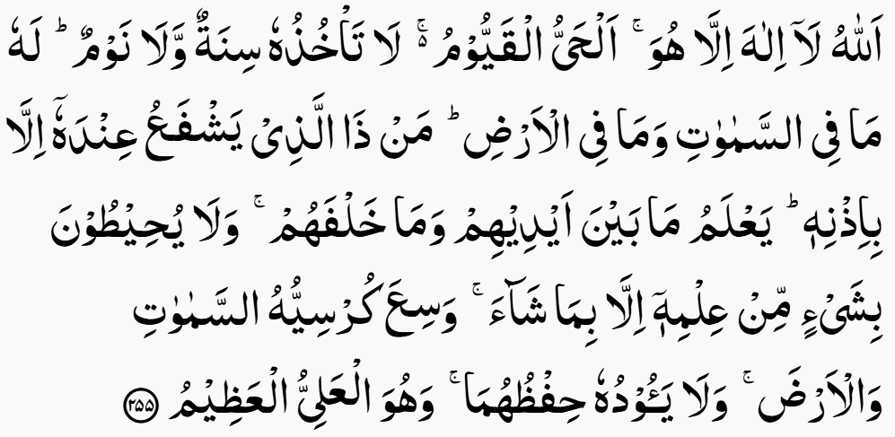

# As-salaamu Alaikum Wa Rahmatullahi Wa Barakatu

The Naskh Nastaleeq IndoPak text showcased on Quran.com and QuranWBW.com is a refined version of the standard IndoPak script available online. This improved text is designed to closely mirror the authentic IndoPak mushaf, complete with accurate pause marks and rounded ayah icons, enhancing its visual and resemblance to the traditional manuscript.

We have done our best efforts to make available this Indopak Quran Text in the best of its form and Quality.

## Downloads

You can download the latest **IndoPak Hanafi** version data and font files from the following link:
**[https://qul.tarteel.ai/resources/quran-script/59](https://qul.tarteel.ai/resources/quran-script/59)**.

> Please note: The previously included data and font files have been removed from this repository, as they are no longer being actively maintained.
> To ensure you are using the most accurate and up-to-date resources, please refer to the link above.

The download link for the **IndoPak Madinah** version will be added here once it becomes available.

## Preview

You can preview the fonts live on https://quran.com or https://quranwbw.com.

## Credits

Made by Ayman Siddiqui and R. Siddiqua for www.QuranWBW.com and www.Quran.com for Sadaqa-e-Jaria purposes only.

_DO NOT SELL, MANIPULATE, DISTRIBUTE WITHOUT CREDITS OR TAMPER IN ANY FORM OR MANNER._

Jazak'Allahu Khair.
